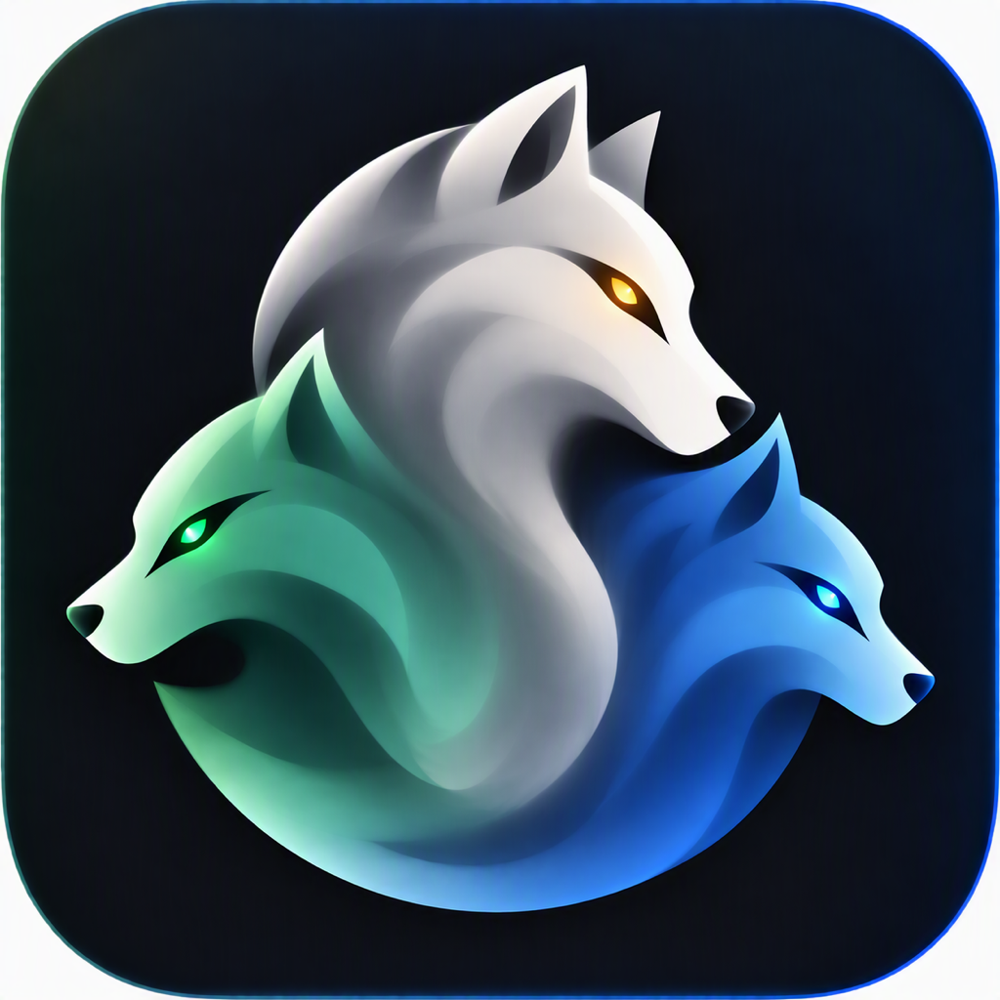
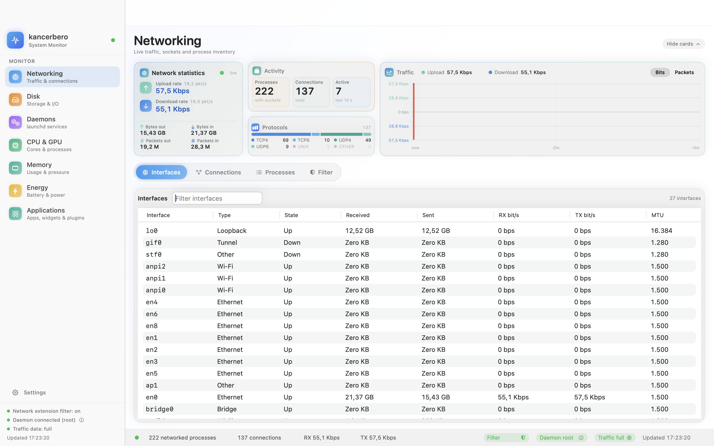
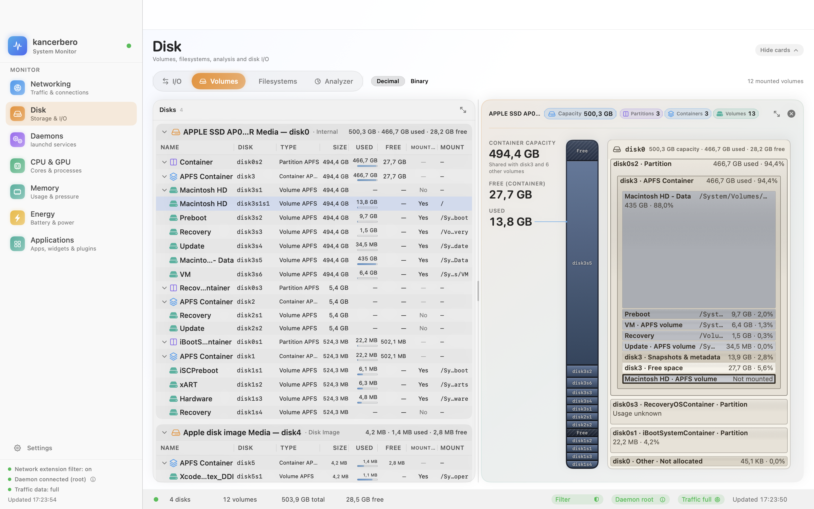
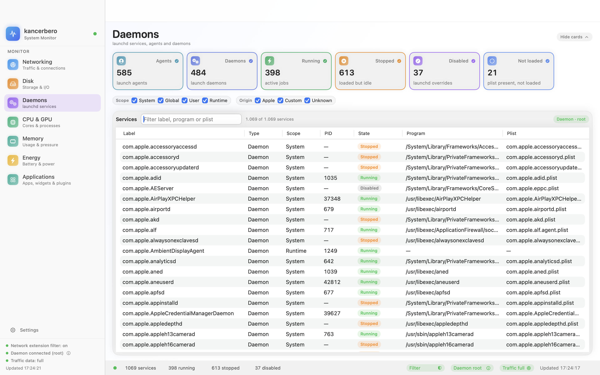
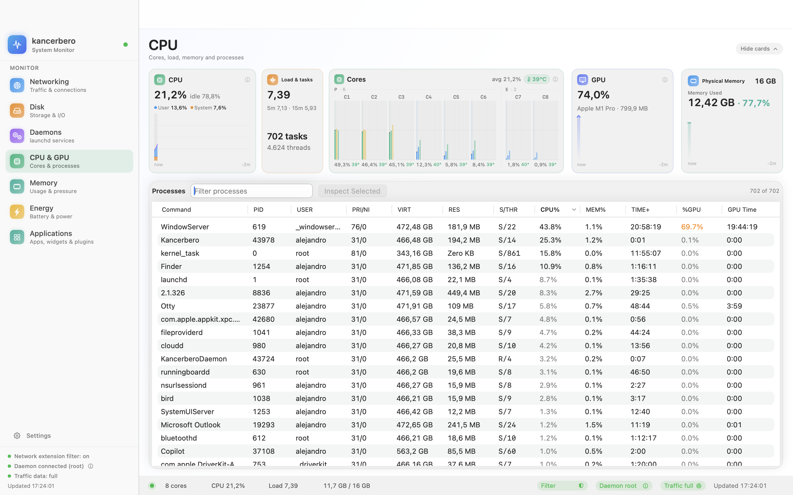
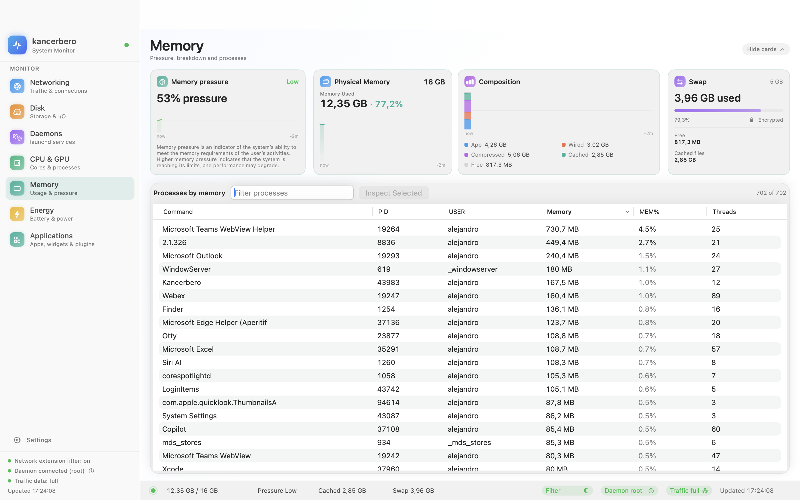
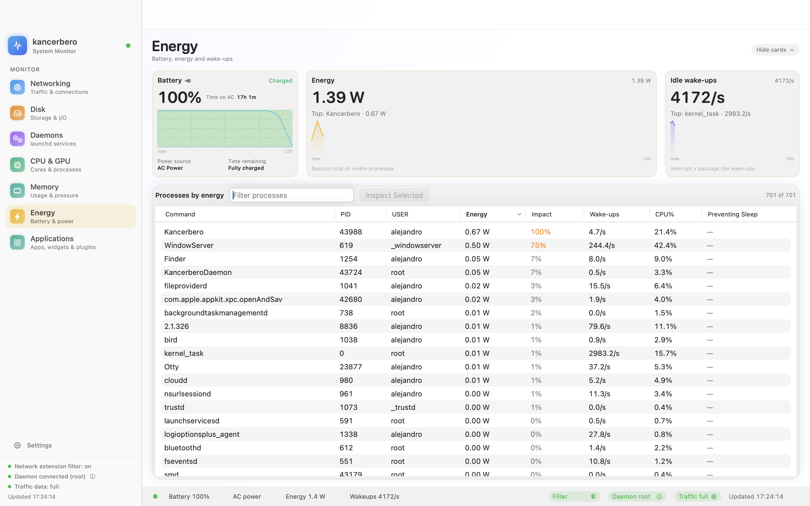
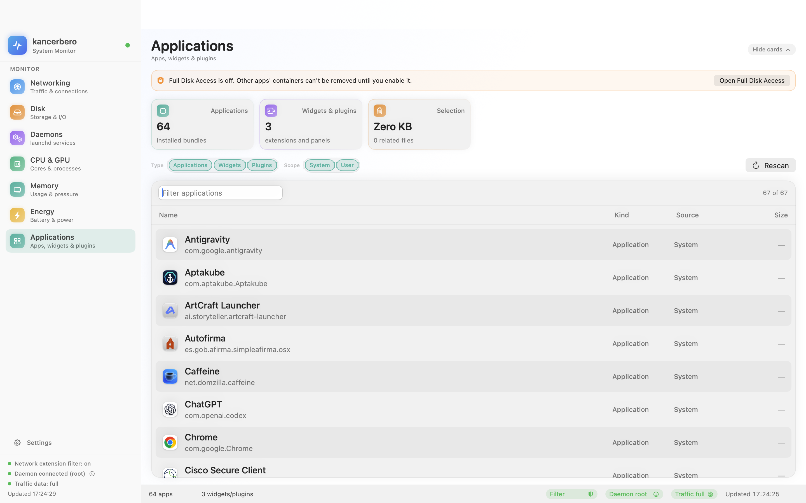
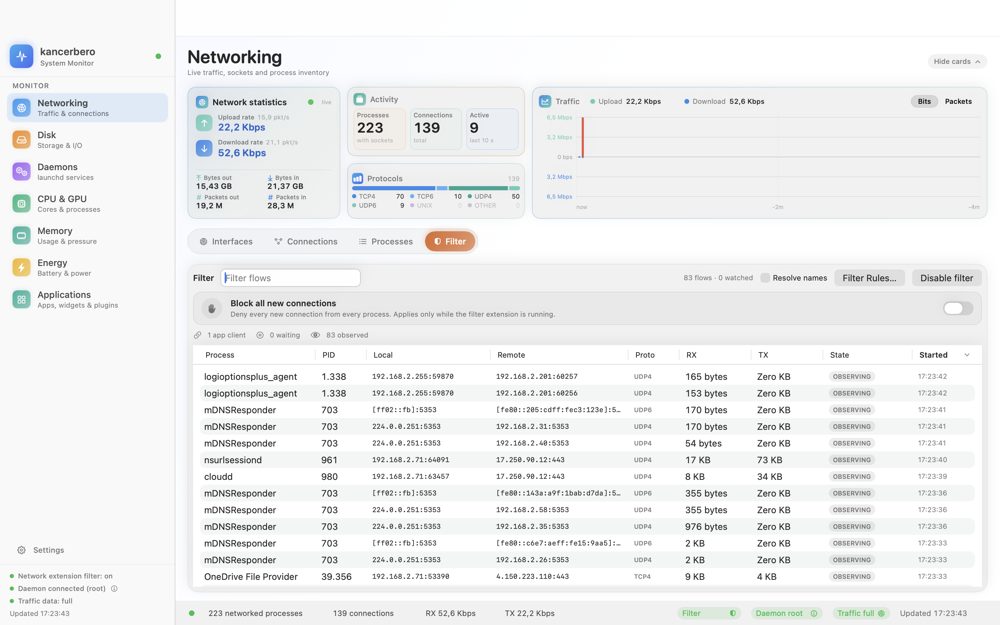

<p align="center">
  
</p>

<h1 align="center">Kancerbero</h1>

<p align="center">
  <strong>Every byte, every process, every disk sector — in one native window.</strong><br>
  A fast, private, beautifully native system monitor for macOS.
</p>

<p align="center">
  <a href="https://kayros.uno"></a>
  <a href="https://github.com/kayrosuno/kancerbero/releases/latest"></a>
  <a href="docs/kancerbero.md"></a>
</p>

<p align="center">
  
  
  
  
  
  
</p>

<p align="center">
  <a href="#why-kancerbero">Why Kancerbero</a> ·
  <a href="#everything-in-one-window">Features</a> ·
  <a href="#screenshots">Screenshots</a> ·
  <a href="#mac-app-store-vs-direct-download">Editions</a> ·
  <a href="#requirements--installation">Install</a> ·
  <a href="#documentation">Docs</a>
</p>

---

<p align="center">
  
</p>

<p align="center"><sub>Live per-process traffic, sockets and interface counters, with a mirrored upload/download graph.</sub></p>

**Kancerbero** is the system monitor your Mac deserves: the depth of Activity Monitor, the
clarity of a modern dashboard, and a set of tools Apple never bundled — all in one native
SwiftUI app. Watch which app is really using the network, map every folder on your disk, control
launchd services without opening Terminal, and decide which connections are allowed to leave
your Mac.

No accounts. No analytics. No cloud. Kancerbero reads what macOS exposes locally and keeps it
there.

> **The name:** Kancerbero is a play on *Cerberus*, the three-headed guardian of the gates. Its
> three wolves watch your network, your disks and your processes.

## Why Kancerbero

- **Know who is using the network.** See per-process upload and download rates, every open
  socket, every connection, every interface — not just the totals.
- **Find what is eating your disk.** Scan any folder or volume and explore an interactive
  sunburst map, the largest files, and the folders that actually take up space.
- **Control launchd without the Terminal.** Browse agents and daemons, filter by scope, origin
  and state, and start, stop, load or disable them from one inspector.
- **Catch CPU and GPU hogs.** Per-core history and temperatures, GPU usage per process, load
  averages, task and thread counts — in a dashboard that stays readable at a glance.
- **Understand memory pressure.** App, wired, compressed and cached memory, swap, pressure
  history, and the processes responsible for it.
- **See which app drains the battery.** Per-process energy impact, wake-ups and the battery
  history of the last 12 hours.
- **Approve connections, app by app.** A real network filter with per-app rules, remembered
  decisions and a fail-closed default — the firewall macOS should have shipped with.
- **Keep the essentials in the Dock.** Turn the Dock icon into a live CPU, memory, network,
  disk, GPU or energy graph, Activity Monitor style.

## Everything in one window

<table width="100%">
  <tr>
    <td width="50%" valign="top">
      <h3>🌐 Networking</h3>
      <p>Per-process traffic from <code>NetworkStatistics</code>, connections and sockets, protocol breakdown, interface counters and a 120-sample mirrored graph. Sort, filter and inspect any process.</p>
    </td>
    <td width="50%" valign="top">
      <h3>💽 Disk &amp; Analyzer</h3>
      <p>Native APFS hierarchy with a treemap and a capacity rail, filesystems table, and a <code>getattrlistbulk</code> analyzer with a radial map and largest-files list.</p>
    </td>
  </tr>
  <tr>
    <td width="50%" valign="top">
      <h3>⚙️ Daemons</h3>
      <p>Every launchd agent and daemon, including runtime jobs. Filter by type, scope, origin and state; inspect its plist, program, arguments and environment.</p>
    </td>
    <td width="50%" valign="top">
      <h3>🧠 CPU &amp; GPU</h3>
      <p>Per-core load and temperature, package temperature, load average, tasks and threads, and a sortable process table with <code>%GPU</code> and GPU time.</p>
    </td>
  </tr>
  <tr>
    <td width="50%" valign="top">
      <h3>🧮 Memory</h3>
      <p>Memory pressure with history, composition (app, wired, compressed, cached, free), swap, and the top processes by resident memory.</p>
    </td>
    <td width="50%" valign="top">
      <h3>🔋 Energy</h3>
      <p>Battery state and 12-hour charge graph, per-process watts, impact, wake-ups and “Preventing Sleep” status.</p>
    </td>
  </tr>
  <tr>
    <td width="50%" valign="top">
      <h3>🗂 Applications</h3>
      <p>Installed apps, widgets and plugins, with their related containers, caches and leftovers — ready to review before removing.</p>
    </td>
    <td width="50%" valign="top">
      <h3>🛡 Network Filter</h3>
      <p>See every flow the system extension observes. Watch a process and approve or deny each new connection, once or remembered per app or app + destination.</p>
    </td>
  </tr>
  <tr>
    <td width="50%" valign="top">
      <h3>🖥 Dock icons</h3>
      <p>Nine live Dock icon styles: CPU history, network, disk, memory pressure, GPU, energy and more. The window can be closed; the icon keeps working.</p>
    </td>
    <td width="50%" valign="top">
      <h3>⌨️ Built for power users</h3>
      <p>Keyboard shortcuts for every section, collapsible cards, resizable table layouts and a contextual status bar that explains the numbers.</p>
    </td>
  </tr>
</table>

## Screenshots

<table width="100%">
  <tr>
    <td width="50%" valign="top">
      
      <p><sub><b>Disk</b> — APFS containers, volumes, capacity and a nested treemap.</sub></p>
    </td>
    <td width="50%" valign="top">
      
      <p><sub><b>Daemons</b> — 1,000+ launchd jobs, filtered and inspectable.</sub></p>
    </td>
  </tr>
  <tr>
    <td width="50%" valign="top">
      
      <p><sub><b>CPU &amp; GPU</b> — per-core history, temperatures, load and top processes.</sub></p>
    </td>
    <td width="50%" valign="top">
      
      <p><sub><b>Memory</b> — pressure, composition, swap and the hungriest apps.</sub></p>
    </td>
  </tr>
  <tr>
    <td width="50%" valign="top">
      
      <p><sub><b>Energy</b> — battery history, watts per app and idle wake-ups.</sub></p>
    </td>
    <td width="50%" valign="top">
      
      <p><sub><b>Applications</b> — installed bundles, widgets, plugins and leftovers.</sub></p>
    </td>
  </tr>
</table>

<p align="center">
  
</p>

<p align="center"><sub><b>Network Filter</b> — observe every flow, arm “Block all new connections”, and decide per process with remembered rules.</sub></p>

## What makes it different

- **Same foundations as Activity Monitor.** Network accounting comes from
  `NetworkStatistics.framework`, disk data from IOKit and DiskArbitration, process data from
  `libproc`, temperatures from IOHID and GPU usage from IOAccelerator. The main views read those
  sources directly instead of shelling out; the process inspector keeps an `lsof` fallback.
- **A real fail-closed filter.** The content-filter system extension asks Kancerbero before a
  watched process opens a connection. If the app cannot answer, the connection is denied — not
  allowed.
- **Root is optional.** Run in local mode for your own processes, or enable the signed
  background helper to see every user, every socket and every system service.
- **Native, not a web view.** SwiftUI, Liquid Glass, Canvas graphs and `NSDockTile` — small,
  fast and at home on macOS.
- **Private by design.** Everything is computed on your Mac. Outside of optional reverse-DNS
  lookups, the only network request is the signed Sparkle update feed.
- **Open source.** Apache-2.0, with the reverse-engineering evidence and the architecture
  documented in [`docs/`](docs).

## Mac App Store vs Direct download

Kancerbero is **coming to the Mac App Store**. The App Store edition is sandboxed, as Apple
requires; the direct download from [kayros.uno](https://kayros.uno) is the full edition.

| | Mac App Store | Direct download |
|---|:---:|:---:|
| Networking, CPU & GPU, memory, energy, daemons and applications dashboards | ✅ | ✅ |
| Network filter with per-app approvals and remembered rules | ✅ | ✅ |
| Disk analyzer | Folders you choose | Any folder or volume |
| Root background helper for all users, privileged cleanup and system services | — | ✅ |
| Mount, unmount and eject volumes | — | ✅ |
| Updates | Mac App Store | Signed Sparkle feed |

> Power users: choose the direct download. The App Store edition shows a clear notice wherever
> the sandbox prevents an action, with a link to the full version.

## Requirements & installation

- **macOS 14 Sonoma or later**, Apple silicon.
- The network filter system extension requires **macOS 15.6 or later**, a notarized build in
  `/Applications`, and your approval in **System Settings → General → Login Items & Extensions**.
- Full functionality of cross-user process and socket views needs the optional root helper.

**Download** the signed and notarized DMG or ZIP from [kayros.uno](https://kayros.uno), drag
**Kancerbero** to `/Applications`, and launch it. Updates are delivered by Sparkle and verified
with EdDSA signatures.

**Build from source:**

```bash
git clone https://github.com/kayrosuno/kancerbero.git
cd kancerbero

./scripts/build.sh            # Debug build (ad-hoc signing)
./scripts/build-release.sh    # Developer ID build + notarization + DMG

./scripts/verify.sh           # compare collectors with netstat, lsof and Activity Monitor
```

A Developer ID certificate and two Developer ID provisioning profiles (app and filter) are
required for the release build; see [`docs/kancerbero.md`](docs/kancerbero.md) and
[`docs/verification.md`](docs/verification.md).

## Documentation

The complete technical reference is in Spanish:

| Document | Contents |
|---|---|
| [`docs/kancerbero.md`](docs/kancerbero.md) | Build, run, features, daemon, disk, verification and known limitations |
| [`docs/architecture.md`](docs/architecture.md) | Targets, XPC, collectors, UI structure and data flow |
| [`docs/daemons-and-libraries.md`](docs/daemons-and-libraries.md) | Binaries, permissions, installation and the libraries used |
| [`docs/private-apis.md`](docs/private-apis.md) | Reverse engineering of Activity Monitor and the evidence behind each data source |
| [`docs/security.md`](docs/security.md) | Security model, XPC authorization, entitlements and sandboxing |
| [`docs/verification.md`](docs/verification.md) | Reproducible checks and comparisons with system tools |
| [`docs/updates.md`](docs/updates.md) | Sparkle feed, keys, releases and diagnostics |

## Privacy

Kancerbero has no accounts, no analytics and no telemetry. It does not upload your data and does
not phone home. Process, network, disk and energy information is collected on-device and kept in
memory. Apart from the reverse-DNS lookups you can enable in the tables, the only outbound request
is the signed update check from Sparkle; the network filter talks to its own system extension
over a local Mach service.

## Contributing

Issues and pull requests are welcome. Please keep the project native, dependency-light and
privacy-first. Before opening a PR, run `./scripts/build.sh` and `./scripts/verify.sh`.

If Kancerbero is useful to you, a ⭐ on GitHub helps other Mac users discover it.

## License

[Apache License 2.0](LICENSE).

---

<p align="center">
  <sub>Designed and built with care in SwiftUI by <a href="https://kayros.uno">Kayros</a>.</sub><br>
  <sub>Kancerbero — three wolves at the gates of your Mac.</sub>
</p>
